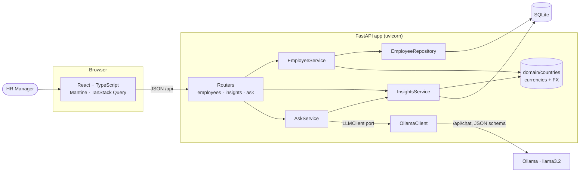
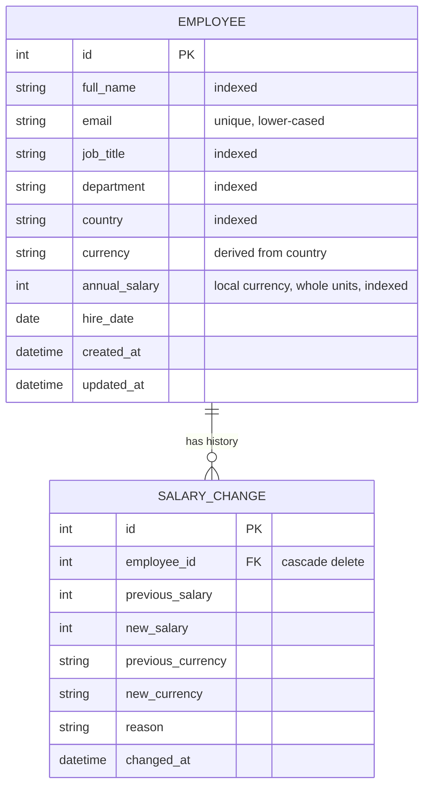
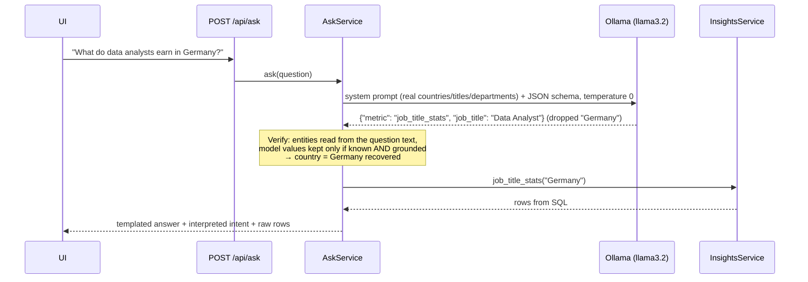

# Architecture

## System overview

In production a single container serves both the API and the built React app (FastAPI
`StaticFiles` + SPA fallback), so there is one thing to deploy.

## Layers (backend)

| Layer | Responsibility | Knows about |
|---|---|---|
| `api/` | HTTP: parsing, status codes, DI of session + LLM, error → status mapping | services, schemas |
| `services/` | Use-cases and business rules; owns the transaction (`commit`) | repositories, domain |
| `repositories/` | Query construction (filters, search, paging, sort) | ORM models |
| `domain/` | Pure rules: supported countries, currency, FX conversion | nothing |
| `ai/` | `LLMClient` protocol, Ollama adapter, `AskService` | insights service |

Dependencies point inwards. Domain errors (`EmployeeNotFoundError`, `DuplicateEmailError`,
`CurrencyChangeRequiresSalaryError`, `UnsupportedCountryError`, `LLMUnavailableError`) are
plain Python exceptions mapped to HTTP in one place ([api/errors.py](../backend/app/api/errors.py)),
so services stay framework-free and unit-testable.

`create_app(settings, llm=...)` is a factory: tests inject an in-memory database and a stub
LLM; production wires the real Ollama client.

## Data model

Composite index `(country, job_title)` serves the most common insight query.

## "Ask AI" flow — the model never produces numbers

The UI shows the interpreted intent as badges ("Country: Germany", "Job title: Data
Analyst"), so the HR manager can see what was answered.

## Frontend

- `api/` — a typed `request()` wrapper (JSON, query strings, FastAPI validation errors
  flattened to readable messages) plus one `api` object mirroring the endpoints.
- `features/<feature>/` — page, components, React Query hooks and their tests side by side.
- Server state lives in TanStack Query (caching, `keepPreviousData` for smooth paging,
  invalidation after writes); UI state stays local. No global store needed.
- Routes are lazy-loaded, so the charting library only downloads for *Pay insights*.
