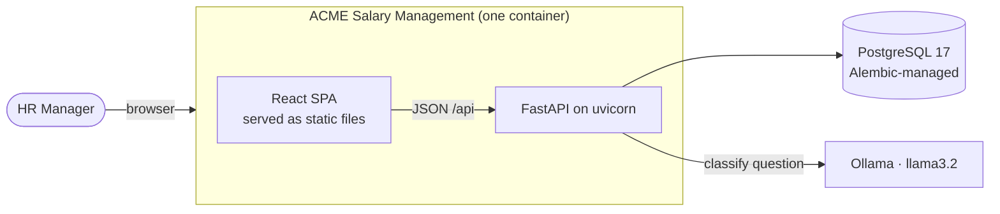
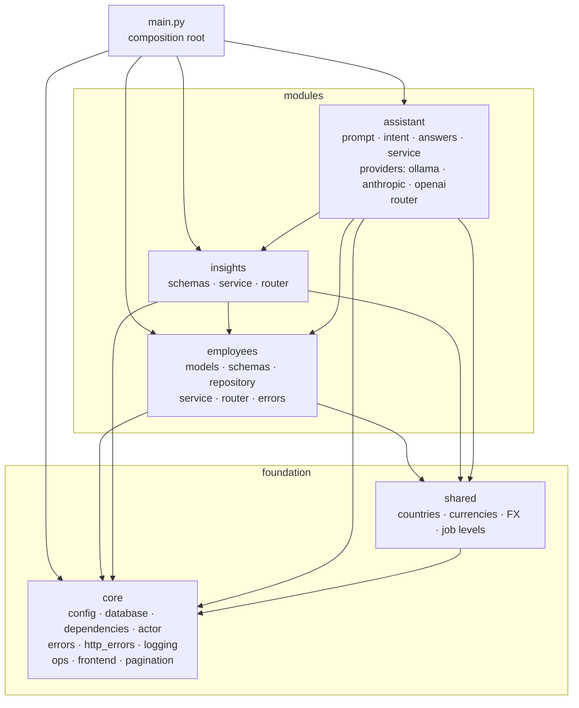
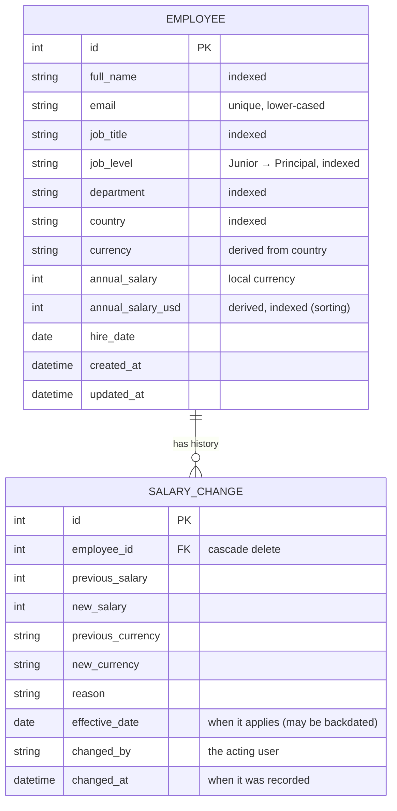

# Architecture

A **modular monolith**: one deployable, organised by business capability, with module
boundaries enforced by tests. Rationale in [ADR 0001](adr/0001-modular-monolith.md).

## System context



## Backend modules



Allowed arrows are exactly those above; `tests/unit/test_architecture.py` fails on any other.

```
backend/
├── app/
│   ├── main.py                 composition root: wires settings, infra, routers
│   ├── core/                   infrastructure, no business logic
│   │   ├── config.py           typed settings (SALARY_* env vars)
│   │   ├── database.py         engine, sessions, Base, required extensions (pg_trgm)
│   │   ├── dependencies.py     SessionDep
│   │   ├── actor.py            who is acting + permissions (the seam SSO would fill)
│   │   ├── errors.py           DomainError → NotFound / Conflict / BusinessRule / PermissionDenied / ServiceUnavailable
│   │   ├── http_errors.py      category → HTTP status, in one place
│   │   ├── logging.py          request id (contextvar), access log
│   │   ├── ops.py              /api/health (liveness), /api/ready (readiness)
│   │   ├── frontend.py         serves the built SPA
│   │   └── pagination.py       Page[T]
│   ├── shared/countries.py     countries, currencies, static FX (ADR 0002)
│   ├── shared/levels.py        the job-level ladder (Junior → Principal)
│   ├── modules/
│   │   ├── employees/          CRUD, search, salary audit trail
│   │   ├── insights/           read-only pay analytics (medians, levels, outliers, bands, trends)
│   │   └── assistant/          salary intelligence: questions → allow-listed analytics (ADR 0008)
│   └── seed/                   deterministic 10k generator + CLI
├── migrations/                 Alembic, one PostgreSQL baseline (ADR 0007)
└── tests/
    ├── unit/<module>/          services, repository, schemas, resolver, seed
    ├── unit/core/              error mapping, migration drift
    ├── unit/test_architecture.py
    ├── api/                    HTTP contract tests via TestClient
    └── benchmark/              the 11 predefined questions, verified against seeded data
```

### Responsibilities inside a module

| Piece | Does | Doesn't |
|---|---|---|
| `router.py` | HTTP parsing/validation, status codes, DI | business rules, SQL |
| `service.py` | use-cases, business rules, **owns the transaction** | know about HTTP |
| `repository.py` | query construction (filters, search, paging, sort) | commit, enforce rules |
| `schemas.py` | API contracts (Pydantic) | persistence |
| `models.py` | persistence mapping (SQLAlchemy) | validation for the API |
| `errors.py` | domain errors from a `core.errors` category | pick status codes |

### Error handling
Services raise domain errors; `core/http_errors.py` maps the *category* to a status:
`NotFound → 404`, `Conflict → 409`, `BusinessRule → 422`, `PermissionDenied → 403`,
`ServiceUnavailable → 503`.
Dependency failures return a safe `public_message` and log internal details. Adding an
error never touches infrastructure.

### Observability
Every request gets an `X-Request-ID` (an incoming one is propagated if it is safe), carried
in a contextvar onto every log line, plus one access log line (method, path, status,
duration). `/api/health` reports liveness; `/api/ready` checks the database.

## Data model


Every read path is index-backed ([ADR 0006](adr/0006-indexing.md)): composite indexes for
filtered lists (ending in `id`, the paging tie-breaker), covering indexes for insights, an indexed stored `annual_salary_usd` for
cross-currency sorting, and `pg_trgm` GIN indexes for substring search. `tests/unit/test_query_plans.py` fails if any query falls back to a
full scan or in-memory sort. The schema is owned by Alembic; a test fails if models and
migrations drift.

## Salary intelligence: the model never produces numbers

Decision record: [ADR 0008](adr/0008-natural-language-salary-intelligence.md).

```mermaid
sequenceDiagram
    participant UI
    participant R as router
    participant S as AskService
    participant L as Model provider<br/>(Ollama · Claude · OpenAI)
    participant I as IntentResolver
    participant A as AnswerComposer
    participant Q as InsightsService
    UI->>R: POST /api/ask {question, provider?}
    R->>S: ask(question) as actor
    S->>L: grounded prompt + strict JSON schema
    L-->>S: {"metric": "department_stats", "departments": [...]}
    S->>I: resolve(raw, question)
    Note over I: question's own entities win;<br/>model guesses kept only if known + grounded<br/>in unclaimed words; median read from text
    S->>A: compose(intent, question)
    Note over A: ambiguous → clarification<br/>individual-level without permission → forbidden
    A->>Q: allow-listed read-only SQL aggregate
    Q-->>A: rows
    A-->>UI: templated answer + table + chart + scope + suggestions
```

| Operation | Answers | Basis |
|---|---|---|
| `org_summary` | headcount, payroll, average and median | USD at fixed FX |
| `country_stats` | one country, or all ranked | local + USD |
| `job_title_stats` | a role in a country, or across countries | local (+ USD to compare) |
| `department_stats` | one, several (compare) or all ranked by average/median | USD |
| `level_stats` | pay gap between levels | like for like: same title and country |
| `salary_bands` | distribution | USD bands |
| `outliers` | ≥25% from peers (same title, level, country) | local; needs permission |
| `above_department_average` | who and how many | USD; needs permission |
| `salary_trends` | changes and raises per month, last 12 months | by effective date |

`IntentResolver` and the providers' adapters are tested without a database or network; the
composer is tested against Postgres with a fake model; `tests/benchmark` checks 11 questions
end to end against an oracle computed from the seed generator.

## Frontend

```
frontend/src/
├── main.tsx                 bootstraps <AppProviders><App/></AppProviders>
├── app/                     shell (header, lazy routes), providers, theme
├── shared/
│   ├── api/                 typed fetch client (+ApiError), Page<T>
│   └── lib/format.ts        money/number/date formatting
├── features/
│   ├── employees/           api.ts · types.ts · hooks.ts · EmployeesPage · components/
│   ├── insights/            api.ts · types.ts · InsightsPage
│   └── assistant/           api.ts · types.ts · ChatWidget · AnswerEvidence (chart + table)
└── test/                    render-with-providers, fixtures, jsdom setup
```

- Each feature mirrors a backend module: its `types.ts` mirrors the module's `schemas.py`.
- **Server state** lives in TanStack Query (cache, `keepPreviousData` paging, invalidation
  after writes) and is never copied into a store.
- **Client state that outlives a component** lives in small Zustand stores owned by their
  feature: `employees/directoryStore` (search, filters, sort, page, so they survive a trip to
  insights; its actions own rules like "a new filter goes back to page 1") and
  `assistant/assistantStore` (conversation, open state, model choice; the conversation and
  choice are saved in the browser via `persist`, with storage errors swallowed). Everything
  else (form drafts, dialogs) stays in component state. Tests reset the stores after each test.
- Routes: `/` employees (home), `/insights` pay insights. No sidebar: the home page links to
  insights and back. The pay assistant is a floating chat mounted once in the shell, so its
  conversation survives navigation; the old `/ask` URL opens it.
- Routes are lazy-loaded; the charting library is one chunk fetched by *Pay insights* or the
  first chat answer with a chart.
- Theme (`app/theme.ts`): green brand palette with green-tinted neutrals; WCAG contrast of
  buttons and dimmed text is asserted in tests.
- `@/` import alias; features don't import each other.
