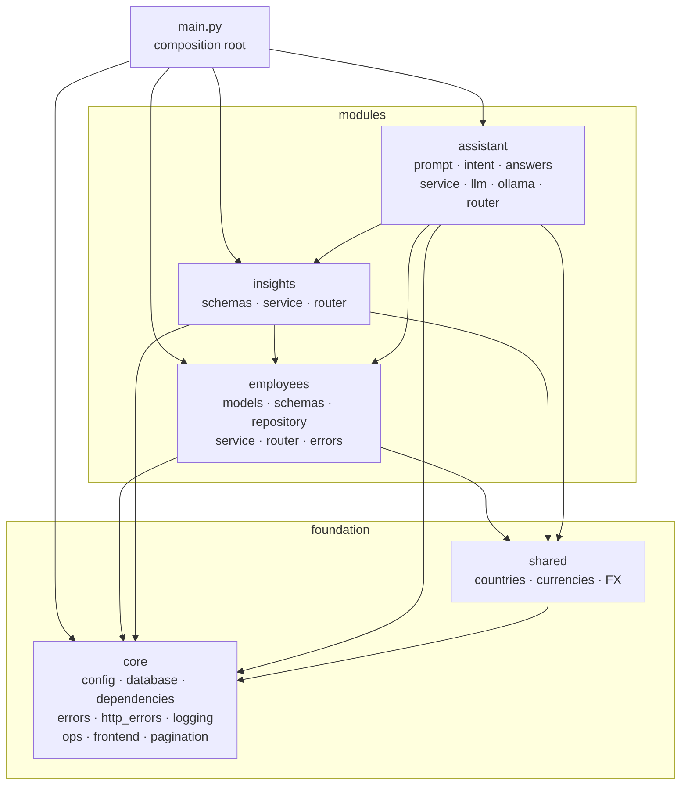
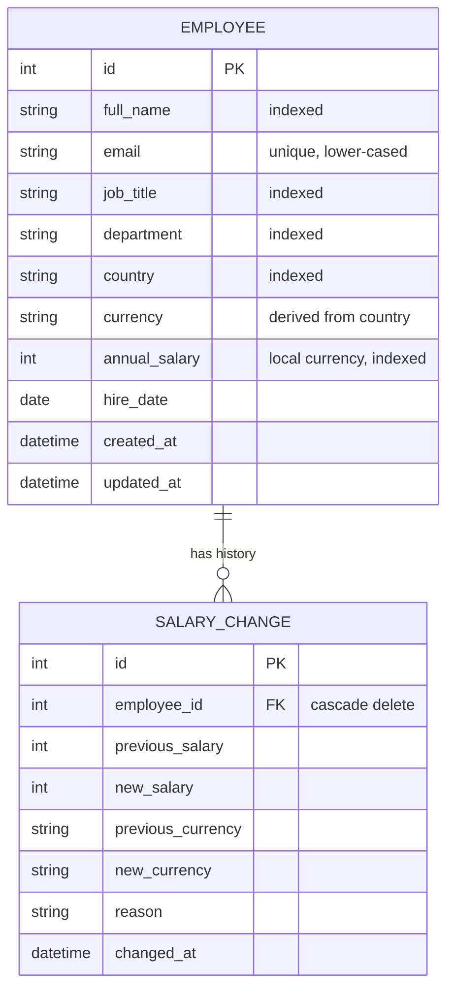

# Architecture

A **modular monolith**: one deployable, organised by business capability, with module
boundaries enforced by tests. Rationale in [ADR 0001](adr/0001-modular-monolith.md).

## System context


## Backend modules



Allowed arrows are exactly those above; `tests/unit/test_architecture.py` fails on any other.

```
backend/
├── app/
│   ├── main.py                 composition root: wires settings, infra, routers
│   ├── core/                   infrastructure, no business logic
│   │   ├── config.py           typed settings (SALARY_* env vars)
│   │   ├── database.py         engine, sessions, Base (SQLite pragmas)
│   │   ├── dependencies.py     SessionDep
│   │   ├── errors.py           DomainError → NotFound / Conflict / BusinessRule / ServiceUnavailable
│   │   ├── http_errors.py      category → HTTP status, in one place
│   │   ├── logging.py          request id (contextvar), access log
│   │   ├── ops.py              /api/health (liveness), /api/ready (readiness)
│   │   ├── frontend.py         serves the built SPA
│   │   └── pagination.py       Page[T]
│   ├── shared/countries.py     countries, currencies, static FX (ADR 0002)
│   ├── modules/
│   │   ├── employees/          CRUD, search, salary audit trail
│   │   ├── insights/           read-only pay analytics
│   │   └── assistant/          plain-English questions (ADR 0003)
│   └── seed/                   deterministic 10k generator + CLI
├── migrations/                 Alembic (ADR 0004)
└── tests/
    ├── unit/<module>/          services, repository, schemas, resolver, seed
    ├── unit/core/              error mapping, migration drift
    ├── unit/test_architecture.py
    └── api/                    HTTP contract tests via TestClient
```

### Responsibilities inside a module

| Piece | Does | Doesn't |
|---|---|---|
| `router.py` | HTTP parsing/validation, status codes, DI | business rules, SQL |
| `service.py` | use-cases, business rules, **owns the transaction** | know about HTTP |
| `repository.py` | query construction (filters, search, paging, sort) | commit, enforce rules |
| `schemas.py` | API contracts (Pydantic) | persistence |
| `models.py` | persistence mapping (SQLAlchemy) | validation for the API |
| `errors.py` | domain errors from a `core.errors` category | pick status codes |

### Error handling
Services raise domain errors; `core/http_errors.py` maps the *category* to a status:
`NotFound → 404`, `Conflict → 409`, `BusinessRule → 422`, `ServiceUnavailable → 503`.
Dependency failures return a safe `public_message` and log internal details. Adding an
error never touches infrastructure.

### Observability
Every request gets an `X-Request-ID` (an incoming one is propagated if it is safe), carried
in a contextvar onto every log line, plus one access log line (method, path, status,
duration). `/api/health` reports liveness; `/api/ready` checks the database.

## Data model


Composite index `(country, job_title)` serves the most common insight query. The schema is
owned by Alembic; a test fails if models and migrations drift.

## Assistant pipeline: the model never produces numbers

```mermaid
sequenceDiagram
    participant UI
    participant R as router
    participant S as AskService
    participant P as prompt
    participant L as Ollama
    participant I as IntentResolver
    participant A as AnswerComposer
    participant Q as InsightsService
    UI->>R: POST /api/ask "What do data analysts earn in Germany?"
    R->>S: ask(question)
    S->>P: build_system_prompt(vocabulary from DB)
    S->>L: question + JSON schema, temperature 0
    L-->>S: {"metric": "job_title_stats", "job_title": "Data Analyst"}
    S->>I: resolve(raw, question)
    Note over I: entities from question text first;<br/>model values kept only if known + grounded<br/>→ country=Germany recovered
    S->>A: compose(intent)
    A->>Q: job_title_stats("Germany")
    Q-->>A: SQL aggregates
    A-->>UI: templated answer + intent + rows
```

`IntentResolver` is pure (no DB, no LLM), so the hallucination guards are unit-tested
directly.

## Frontend

```
frontend/src/
├── main.tsx                 bootstraps <AppProviders><App/></AppProviders>
├── app/                     shell (header, lazy routes), providers, theme
├── shared/
│   ├── api/                 typed fetch client (+ApiError), Page<T>
│   └── lib/format.ts        money/number/date formatting
├── features/
│   ├── employees/           api.ts · types.ts · hooks.ts · EmployeesPage · components/
│   ├── insights/            api.ts · types.ts · InsightsPage
│   └── assistant/           api.ts · types.ts · ChatWidget · answerFormat
└── test/                    render-with-providers, fixtures, jsdom setup
```

- Each feature mirrors a backend module: its `types.ts` mirrors the module's `schemas.py`.
- Server state lives in TanStack Query (cache, `keepPreviousData` paging, invalidation
  after writes); UI state stays local. No global store needed.
- Routes: `/` employees (home), `/insights` pay insights. No sidebar: the home page links to
  insights and back. The pay assistant is a floating chat mounted once in the shell, so its
  conversation survives navigation; the old `/ask` URL opens it.
- Routes are lazy-loaded, so the charting library downloads only for *Pay insights*.
- Theme (`app/theme.ts`): green brand palette with green-tinted neutrals; WCAG contrast of
  buttons and dimmed text is asserted in tests.
- `@/` import alias; features don't import each other.
